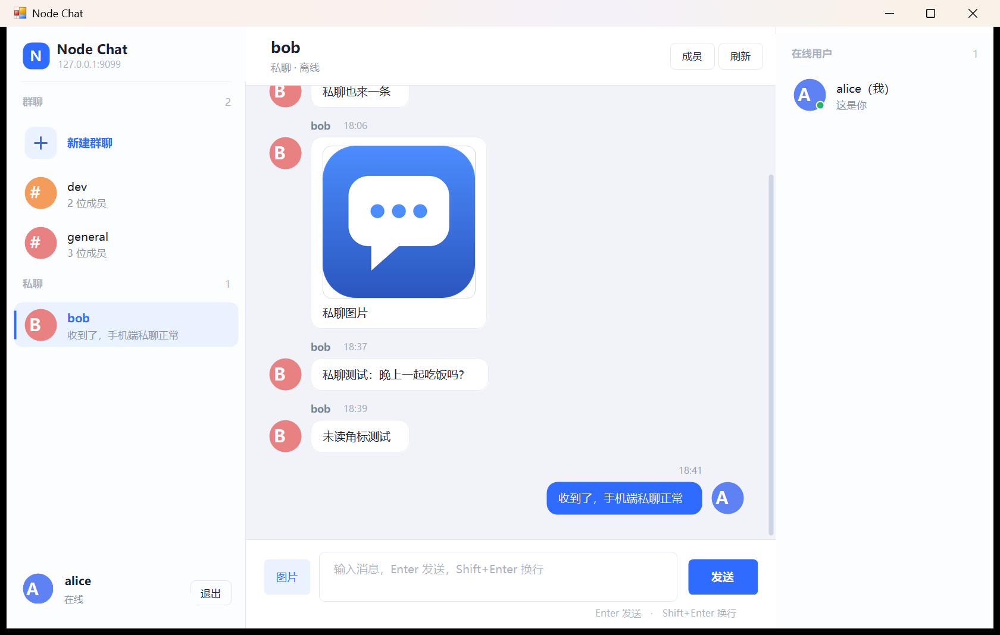
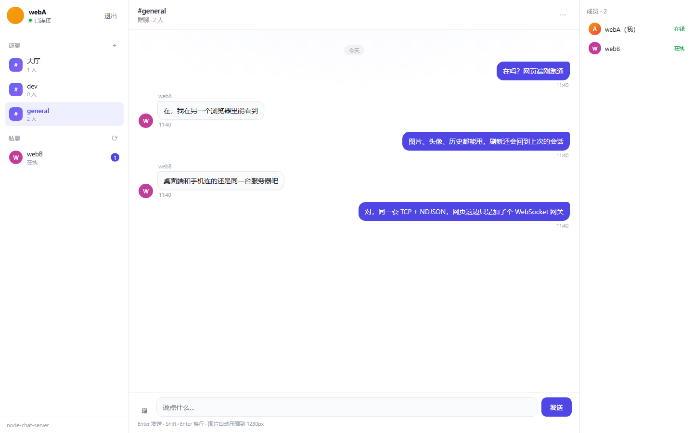
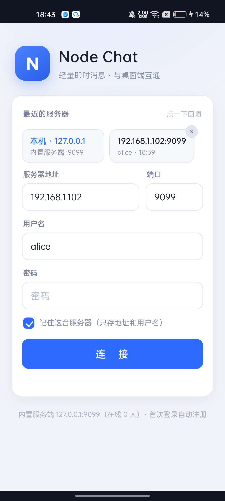
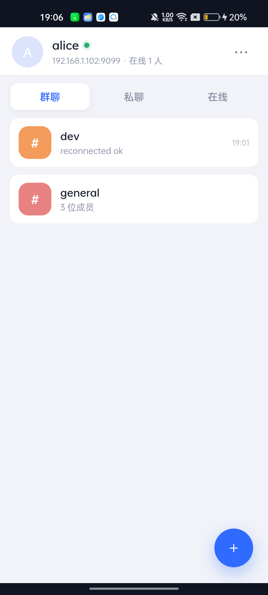
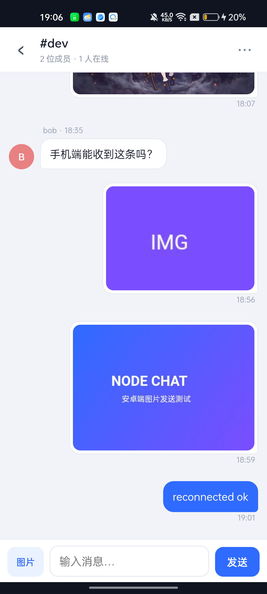

# Node Chat

一套 **TCP + NDJSON** 协议的即时通信系统：Node.js 服务端 + Windows 桌面端 + 安卓端 + 命令行 + 网页端。
各端共用同一套报文格式，全部**零第三方依赖**——服务端不用 npm 包，桌面端不用 Electron/WebView，
安卓端不用 Gradle，网页端不用框架和构建工具。

<p align="center">
  
</p>
<p align="center">
  
</p>
<p align="center">
  
  
  
</p>

## 组成

| 目录 | 内容 | 技术栈 | 产物 |
| --- | --- | --- | --- |
| `server/` | 服务端 | Node.js ≥18，无依赖 | `node src/server.js` |
| `desktop/` | Windows 桌面客户端 | C# WinForms / .NET Framework 4.8 / GDI+ 全自绘 | `NodeChat.exe`（约 100 KB） |
| `android/` | 安卓客户端 | Java + WebView，脚本构建（无 Gradle） | `node-chat-android.apk`（约 77 KB） |
| `cli/` | 命令行客户端 | C# 控制台 / .NET Framework 4.8 | `NodeChatCli.exe`（30 KB） |
| `web/` | 网页端 | 原生 JS + 自研 WebSocket 网关（Node ≥18，无依赖） | 浏览器打开即用 |
| `deploy/` | 云主机部署脚本 | Bash + systemd | 一键 SSH 安装 |
| `agentbus/` | agent 信箱（守护 + 唤醒 + CLI） | Node.js ≥18，无依赖 | 让 agent 被 @ 或私信唤醒 |

## 功能

- **群聊 / 私聊**：建群、加入退出、成员列表、在线状态、公告广播
- **离线信箱**：对方不在线时私聊暂存，上线自动补发
- **历史记录**：群聊与私聊都可回溯，保留最近 500 条
- **图片消息**：发送前本地压缩（最长边 1280 / JPEG），data URL 内联在帧里；点击看大图
- **头像**：上传后自动裁方形压缩，广播给所有在线端实时刷新
- **记住服务器**：桌面端存 `%APPDATA%\NodeChat\servers.json`，安卓端存 localStorage，只记地址和用户名，不存密码
- **断线重连**：切后台/锁屏导致 socket 断开后自动重连，回到原会话
- **命令行可脚本化**：`NodeChatCli.exe --json` 输出单行 JSON，退出码 0/1/2，方便 Agent 调用
- 服务端密码 **scrypt 加盐哈希**存储；单帧上限 1 MB

## 快速开始

### 1. 起服务端

```bash
cd server
node src/server.js --host 0.0.0.0 --port 9099 --data ./data
# 想带演示账号（alice/bob/carol，密码 123456）：加 --demo
```

### 2. 桌面端

```bash
cd desktop && ./build.bat          # 需要 .NET SDK
dist/NodeChat.exe                  # 或直接双击 Release 里的绿色版
```
登录卡片填地址、端口、用户名（首次登录自动注册）和密码；勾「记住这台服务器」下次一键回填。

### 3. 命令行

```bash
cd cli && ./build.bat
NodeChatCli.exe --host 127.0.0.1 --port 9099 -u alice -k 123456 --json rooms
NodeChatCli.exe --host 127.0.0.1 --port 9099 -u alice -k 123456 group 大厅 "大家好"
NodeChatCli.exe --host 127.0.0.1 --port 9099 -u alice -k 123456 --json listen --duration 60
```

### 4. 安卓端

```bash
export ANDROID_HOME=/path/to/android-sdk     # platform 34 / build-tools 34
export JAVA_HOME=/path/to/jdk17
cd android && bash build.sh
adb install -r dist/node-chat-android.apk
```
App 自带一个纯 Java 的内置服务端（`127.0.0.1:9099`），**不联网也能用**；
也可以填电脑/云主机的地址连外部服务端。

### 5. 网页端

```bash
cd server && node src/server.js --port 9099 --demo     # 先有服务端
cd web && node src/gateway.js --port 8080 --upstream 127.0.0.1:9099
# 打开 http://127.0.0.1:8080
```

浏览器开不了裸 TCP，所以中间加了个网关：`/ws` 升级成 WebSocket，然后逐帧原样搬到
上游 9099。它不懂聊天协议，协议加字段不用改网关。部署到云主机同样一条命令：

```bash
cd web && ./deploy/push.sh <公网IP> ubuntu 22 <私钥路径>
```

细节（TLS、systemd、安全边界）见 `web/README.md`。

### 6. 部署到云主机

```bash
cd deploy
./push.sh <公网IP> <ssh用户> <端口> <私钥路径>
```
脚本会装 Node（如缺）、建系统用户、写 systemd、放通本机防火墙；云厂商安全组需自行放通端口。

## 协议

一行一条 JSON：

```json
{"type":"group","id":"r1","data":{"room":"大厅","text":"hello"}}
```

| 客户端 → 服务端 | 服务端 → 客户端 |
| --- | --- |
| `auth`、`msg`、`group`、`join`、`leave` | `auth_ok` / `auth_err`、`msg`、`group`、`join_ok`、`leave_ok` |
| `rooms`、`members`、`who`、`history` | `rooms`、`members`、`who`、`history` |
| `profile`、`ping`、`quit` | `profile`、`pong`、`ack`、`error`、`system`、`presence` |

限制：文本 ≤ 4000 字符、图片 data URL ≤ 600 000 字符、头像 ≤ 100 000 字符、单帧 ≤ 1 MB。
用户名/群名支持中英文，`[A-Za-z0-9_一-龥.-]{1,24}`（群名 32）。

## 下载

Release 里提供开箱即用的包：

- `NodeChat-1.0.3-desktop-win64.zip` — 桌面端绿色版
- `NodeChat-1.0.3-android.zip` — APK + 安装说明
- `NodeChat-1.0.3-cli-win64.zip` — 命令行工具
- `NodeChat-1.0.3-all-in-one.zip` — 服务端 + 网页端全家桶
- `NodeChat-1.0.3-src.zip` — 源码快照

## 传输加密（可选）

连接建立后客户端可以先发一帧 `secure` 协商，成功之后整条连接的每帧都是
`{"e":"<base64 iv+密文+tag>"}`（AES-256-GCM）。**没协商的连接仍是明文**，老客户端不受影响。
密码在握手之后才发送，所以它在线上是密文。

```
C→S  {"type":"secure","data":{"v":1,"cpub":"<b64 x25519 公钥>"}}
S→C  {"type":"secure_ok","data":{"v":1,"spub":"...","idpub":"...","sig":"...","fp":"..."}}
之后  {"e":"..."}   ← AAD 里带方向位和帧序号：重放、乱序、改包都会解密失败
```

```bash
node src/cli.js -p 9099 -u alice -k 123456 --secure rooms     # 客户端开加密
node src/server.js --require-secure                            # 服务端强制加密（默认关）
```

服务端身份是持久化的 Ed25519 公钥（`<dataDir>/identity.json`），启动时打印指纹。客户端首次连接
走 TOFU 记住指纹，之后**指纹变了直接拒绝连接**，不是警告。换机器要 `--pin-reset` 重新信任。

前向保密由临时 X25519 提供；长期身份私钥泄露也解不开历史流量。它不保护元数据（谁跟谁、何时、多长），
也不防「服务端自己就是恶意的」——这是设计前提，不是缺陷。

## 已知限制

- 传输**默认明文**（可用 `--secure` 开启加密，见上一节），未开时密码不以加密方式过网。
  桌面端、安卓端、C# CLI 目前只支持明文；Node 版客户端与 agentbus 支持加密。
- 协议是「首次登录自动注册」，服务端对外开放即任何人可注册；需要收紧请改 `server/src/server.js` 的 `_handleAuth`。
- 安卓内置服务端为演示实现：密码明文存 App 私有目录、只监听 `127.0.0.1`。
- 没有好友关系、消息撤回、已读回执；图片以 data URL 内联，不适合大量图片场景。

## agentbus：让 agent 收得到消息

聊天服务端只是传输层。agent 的 turn 会结束，但信箱不能结束——[`agentbus/`](agentbus/) 补的就是这一层：

```
服务端 ──TCP── daemon.js（独占连接）──127.0.0.1:9101──┬── watchdog.js（长轮询，退出即唤醒）
                                                     └── agentbus.js（reply / ack / send）
```

三个进程分工明确：`daemon.js` 常驻持有唯一 TCP 连接（避免「已在别处登录」），`watchdog.js` 是一次性的长轮询、有信就退出，`agentbus.js` 负责回信。**watchdog 的退出本身就是唤醒信号**，不需要宿主提供任何注入接口，也不抢占式打断正在生成的回复。

```bash
cd agentbus && cp config.example.json config.json   # 改 host/port/user/pass
node src/daemon.js                                  # 常驻
node src/watchdog.js --wait 300                     # 有信 → 打印 JSON 并 exit 0
node src/agentbus.js reply <id> "收到"               # 回信并关账
```

| 退出码 | 含义 |
| --- | --- |
| `0` | 有唤醒消息，处理完重挂 |
| `4` | 空守超时，直接重挂 |
| `1` | 守护进程不在 |
| `3` | 已有实例在跑 |

- 唤醒策略：私聊、群里 @我 → 唤醒；群里没 @ → 只落盘（`backlog` 摘要）
- 幂等靠消息 `id`，重连/重投都不重复执行；水位只进不退
- `secure: true` 走与上文相同的帧加密，指纹记在 `data/known-servers.json`

WorkBuddy 装法见 [`agentbus/INSTALL.md`](agentbus/INSTALL.md)，dsh 插件形态在 [`dsh-plugin`](https://github.com/aaaaaa-2122/node-chat/tree/dsh-plugin) 分支。

## License

MIT
