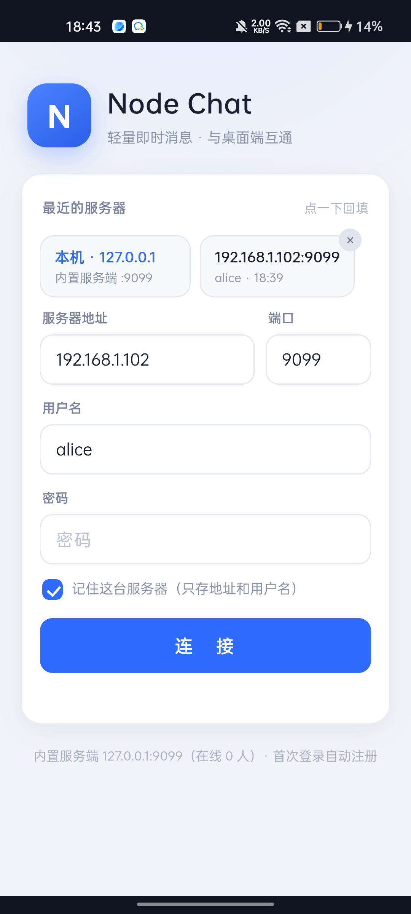
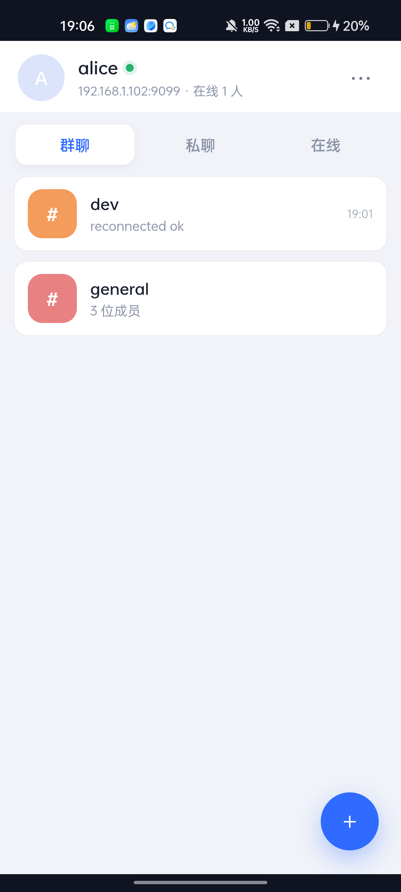
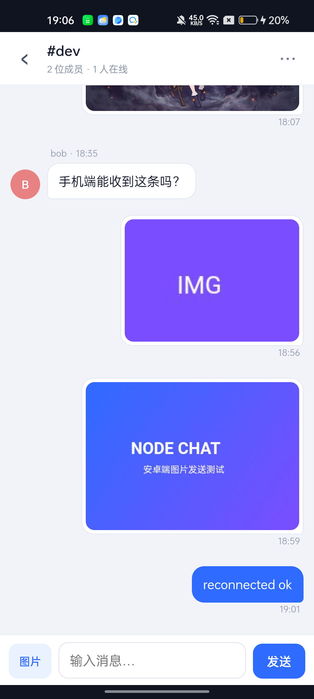

# Node Chat 安卓端

原生 Android 应用（Java + WebView UI）。**不使用 Gradle**，直接用
`javac → d8 → aapt2 → zipalign → apksigner` 命令行构建，产物约 77 KB。
协议与桌面端、`node-chat-full-source` 服务端完全一致（NDJSON over TCP）。

<p align="center">
  
  
  
</p>

## 两种连接方式

| 模式 | 说明 |
| --- | --- |
| **本机内置服务端** | App 内置纯 Java 服务端（`ChatServerCore`，监听 `127.0.0.1:9099`），不联网也能用；首次启动预置「大厅 / 闲聊」两个群。 |
| **外部服务器** | 填电脑的局域网 IP + 端口（例如 `192.168.1.102:9099`），与桌面端连同一个服务端。 |

登录页上方的**「最近的服务器」**会记住成功登录过的地址和用户名（**不保存密码**），点一下卡片即可回填，
卡片右上角 `×` 删除记录。本机模式固定显示一张「本机 · 127.0.0.1」卡片。

## 安装

```bash
adb install -r dist/node-chat-android.apk
```

或把 APK 拷到手机点击安装（需允许安装未知来源应用）。最低 Android 5.0（API 21）。

## 功能

- 群聊 / 私聊列表，未读角标（会话行 + 底部标签合计），最后一条消息预览与时间。
- 文字、图片消息（发送前 canvas 压缩：最长边 1280 / JPEG 0.75）；图片点击全屏查看。
- 历史记录、成员列表、在线用户、公告、新建群、加入 / 退出、头像设置（`⋯ → 我的资料 / 更换头像`）。
- 断线自动重连：进程被系统冻结或切后台导致 socket 断开时，顶栏显示「已断开，N 秒后重连…」，
  回到前台立刻重试，重连后停留在原来的会话。
- 返回键在聊天页返回会话列表（`history.pushState` 拦截），不会直接退出 App。
- 密码框用 `-webkit-text-security` 遮蔽而不是 `type=password`，避免部分国产 ROM 拉起
  **禁止截屏的系统安全键盘**。

## 构建

需要 **JDK 17** + **Android SDK（platform 34 / build-tools 34）**：

```bash
export ANDROID_HOME=/path/to/android-sdk     # Windows 默认 D:/dsh1/node/android-sdk
export JAVA_HOME=/path/to/jdk-17
bash build.sh
# 产物: dist/node-chat-android.apk（调试证书签名，SHA-256 见构建输出）
```

`d8.jar` / `apksigner.jar` / `zipalign` 都取自 Android SDK 的 `build-tools/34.0.0`；`debug.keystore` 已放在仓库内，
每次构建用同一张证书签名，保证覆盖安装能直接升级。整个过程不需要联网。

## 架构

```
┌───────────────────────── APK (com.nodechat.mobile) ─────────────────────────┐
│  MainActivity (Java)                                                        │
│   ├── WebView ── assets/index.html + app.js + style.css   ← UI / 协议层      │
│   │      ↕ AndroidBridge (send / connect / serverInfo ...)                  │
│   │      ↕ WebChromeClient.onShowFileChooser → 系统相册                     │
│   ├── LocalChatClient (Java)  ── TCP ──┐                                    │
│   └── ChatServerCore (Java)   ── TCP ──┴── 127.0.0.1:9099  ← 内置服务端     │
└──────────────────────────────────────────────────────────────────────────────┘
                        │
        外部服务器（PC 上的 node-chat）: 192.168.x.x:9099
```

WebView 里不能直接开 TCP，所以由 Java 持有 socket：JS 通过 `AndroidBridge.send(json)` 发帧，
Java 收到行后回注 `window.__onFrame(frame)`。

## 目录结构

```
app/assets/index.html      登录 / 会话列表 / 聊天 三个页面 + 弹层
app/assets/style.css       浅色卡片风格样式
app/assets/app.js          协议客户端、状态、渲染、图片压缩、断线重连
app/src/.../MainActivity   WebView 宿主、JS 桥、文件选择器、生命周期
app/src/.../LocalChatClient  TCP 客户端（写帧 / 按行读）
app/src/.../ChatServerCore   内置服务端（房间、私聊、离线信箱、持久化）
app/src/.../Json.java        零依赖 JSON 编解码
app/src/.../Protocol.java    协议常量与校验
app/AndroidManifest.xml      1.1.0 / versionCode 3
test/                      核心自测、Node⇄Java 协议互操作、APK 静态校验
```

## 协议

一行一条 JSON，与 PC 版完全一致：

```json
{"type":"group","id":"r1","data":{"room":"general","text":"hello"}}
```

| 客户端 → 服务端 | 说明 | 服务端 → 客户端 | 说明 |
| --- | --- | --- | --- |
| `auth` | 认证（首登自动注册） | `auth_ok` / `auth_err` | 认证结果 |
| `msg` | 私聊 | `msg` | 收到私聊（`offline:true` 为信箱补发） |
| `group` | 群消息（须在群内） | `group` | 收到群消息 |
| `join` / `leave` | 加入 / 退出群 | `join_ok` / `leave_ok` | 群操作结果 |
| `rooms` / `members` / `who` | 查询 | `rooms` / `members` / `who` | 查询结果 |
| `history` | 历史（`room` 或 `to`） | `history` | 历史消息 |
| `profile` | 设置 / 查询头像 | `profile` | 头像结果 |
| `ping` | 心跳 | `pong` / `ack` / `error` | 心跳 / 回执 / 错误 |
| `quit` | 断开 | `system` / `presence` | 系统通知 / 上下线 |

## 图片与头像

| 环节 | 做法 |
| --- | --- |
| 选图 | `<input type="file">` + `WebChromeClient.onShowFileChooser` 唤起系统相册 |
| 压缩 | JS canvas：聊天图最长边 1280 / JPEG 0.78，头像最长边 160 |
| 传输 | data URL 内联在帧的 `image` 字段（单帧上限 1 MB，图片 600 000 字符） |
| 头像 | `profile` 上传 → 服务端落盘并广播 `event:'avatar'` → 各端刷新 |

## 已知限制

- 内置服务端是 demo 级实现：密码明文存于 App 私有目录、只监听 `127.0.0.1`、不做 TLS。
- 图片以 data URL 内联，无视频/文件传输。
- App 被系统杀死时连接中断，重连依赖前台恢复。
