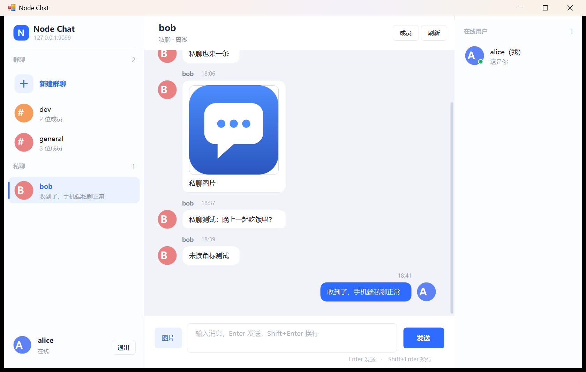

# Node Chat 桌面端

轻量原生 Windows 客户端（C# / WinForms，**.NET Framework 4.8**），与 `node-chat-full-source` 服务端、
安卓端共用同一套 TCP + NDJSON 协议。没有内嵌 Chromium、没有 WebView，全部界面用 GDI+ 自绘，单文件约 100 KB。

<p align="center">
  
</p>

## 快速开始

1. 启动服务端（在 `node-chat-full-source/node-chat` 下）：
   ```bash
   node src/server.js --port 9099 --demo --data ./data
   ```
2. 双击 `dist/NodeChat.exe`，填写地址 / 端口 / 用户名 / 密码，点「进入」。
   首次使用的用户名会自动注册。
3. 也可以带参数直接登录：
   ```bash
   NodeChat.exe --host 192.168.1.102 --port 9099 --user alice --pass 123456
   ```

## 功能

- **最近登录**：登录页下拉框记住用过的「地址:端口 + 用户名」，可一键回填、可删除（密码不保存）。
- 三栏布局：左（群聊 / 私聊列表 + 未读角标）、中（消息流 + 输入区）、右（在线用户 + 群成员）。
- 群聊、私聊、历史记录、成员列表、在线状态、公告、退出/加入群、新建群。
- 图片消息：点「图片」选择，或直接把图片**拖进窗口**即可发送；点击图片可放大（滚轮缩放、拖动、另存、复制）。
- 头像：点左下角头像上传，本地裁剪为方形并压缩后再上传。
- Enter 发送，Shift+Enter 换行；断线后自动重连并在标题栏提示。

## 构建

需要 .NET SDK（含 .NET Framework 4.8 目标包）与 Windows：

```bash
build.bat                 # = dotnet build -c Release，然后复制到 dist\NodeChat.exe
```

> 仓库里带了一个 `NuGet.Config`，用于清空指向 Visual Studio 共享目录的 fallback 包文件夹，
> 否则在某些只装了 SDK 的机器上会报 `无法找到回退包文件夹`。

## 数据文件

| 路径 | 内容 |
| --- | --- |
| `%APPDATA%\NodeChat\servers.json` | 最近登录的服务器（地址、端口、用户名、时间），最多 12 条 |
| `%APPDATA%\NodeChat\settings.json` | 窗口尺寸/位置、上次会话、记住服务器开关等 |

删掉这两个文件即可恢复到「第一次运行」的状态。

## 源码结构

```
src/Json.cs          极简 JSON 解析/序列化
src/Protocol.cs      协议常量、帧构造
src/Net.cs           TCP 客户端（后台线程读行、帧队列、登录握手）
src/Servers.cs       服务器记忆（servers.json）与偏好设置
src/UiKit.cs         配色、绘制工具、圆角按钮、输入框、头像、Toast、输入弹层
src/SideList.cs      左侧自绘会话列表
src/MessageView.cs   消息气泡 / 图片 / 日期分隔 / 系统消息
src/MainForm.cs      主窗口，帧分发与全部交互
src/LoginForm.cs     登录卡片 + 最近服务器
src/ImageViewer.cs   大图查看
src/Program.cs       DPI 处理、全局异常兜底
```
